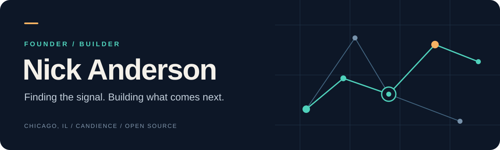

I build software that helps people make sense of what is happening and decide what to do next.

My main focus is **[Candience](https://www.candience.com)**, where I’m building **Predictive Experience Intelligence (PXi)** for talent acquisition: candidate-experience risk, pattern detection, and workflow-native intervention.

Alongside that work, I build tools for event intelligence, local security analysis, and connections between people and their dogs.

## Selected work

| Project | What I’m building | Explore |
| :--- | :--- | :--- |
| **Candience** | An experience intelligence layer for talent acquisition. Built for prediction, not collection. | [Website](https://www.candience.com) |
| **Chronicle** | A Python library that turns news streams into clustered events and source-linked timelines. | [Repository](https://github.com/dukeblue1994-glitch/chronicle) · [PyPI](https://pypi.org/project/chronicle-events/) |
| **AegisLab** | A local lab for synthetic security events, detection analytics, and reproducible reports. | [Repository](https://github.com/dukeblue1994-glitch/aegislab) |
| **Sniffr** | A web and mobile project for dogs and the people who care for them. | [Repository](https://github.com/dukeblue1994-glitch/Sniffr_App) |

## How I approach the work

- **Start with the signal.** Find the pattern that changes a decision.
- **Keep the path to action clear.** Useful software should help someone take the next step.
- **Make it inspectable.** Clear interfaces, source-linked results, and reproducible examples.

## Around the code

Python · TypeScript · React · FastAPI · PostgreSQL · SQLite

Based in Chicago. Building Candience and maintaining open-source projects as they develop.

[Visit Candience](https://www.candience.com) · [Connect on LinkedIn](https://linkedin.com/in/nickanderson-candience)
